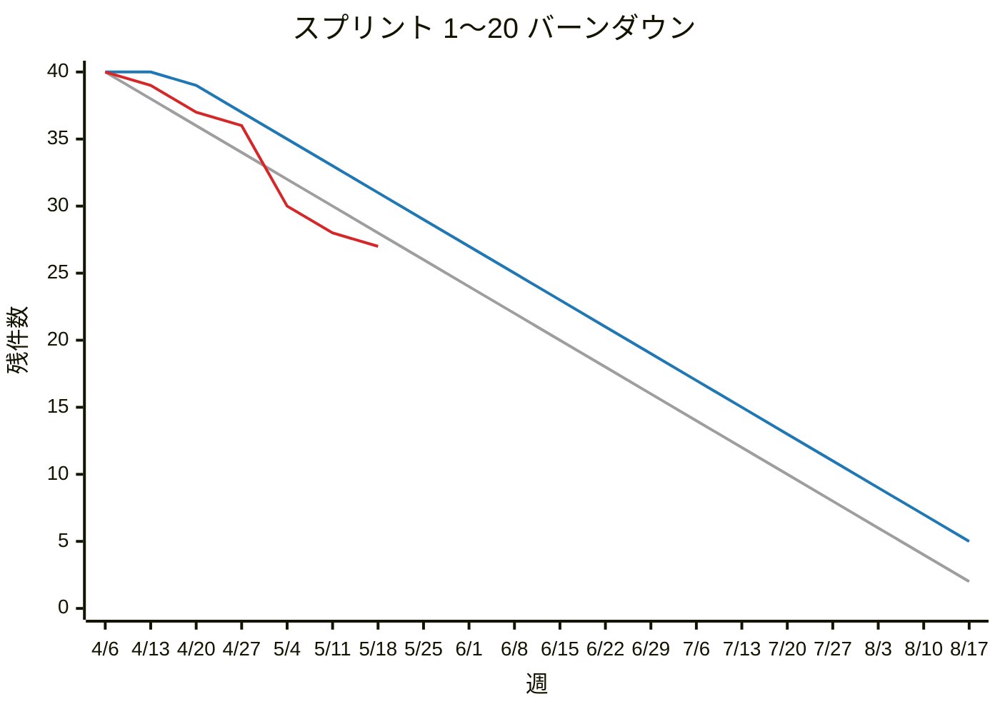

# Mermaid xychart の GitHub / GitLab での表現力

調査日: 2026-10-01 / 対象 issue: #4（親: #1）

バーンダウンチャート（理想・予定・実績の3本の折れ線）を Mermaid の xychart で描くとき、GitHub と GitLab 19.x の Markdown プレビューで何がどこまで表示できるかをまとめる。

- **[事実]**: 一次情報（ソースコード、公式ドキュメント、CHANGELOG、仕様）で確認したこと。出典 URL を付ける
- **[実測]**: 実際のレンダラーで描画して確認したこと。手順は末尾の「検証方法」に書く
- **[推測]**: 根拠からの推論で、確認はしていないこと

## 結論（要約）

| 項目 | GitHub（2026-10-01 時点） | GitLab 19.0〜19.3 | GitLab 19.4 以降 |
| --- | --- | --- | --- |
| 同梱 Mermaid | v11.17.2 [実測] | 11.13.0 [事実・実測] | 11.16.1 [事実] |
| `xychart-beta` / `xychart` | 両方使える | 両方使える | 両方使える |
| 複数の line 系列 | 可 | 可 | 可 |
| 凡例（系列名の表示） | **出る**（11.17.0 以降） [実測] | **出ない** [実測] | **出ない**（11.17.0 未満） [推測] |
| 系列ごとの色（`plotColorPalette`） | 可 [実測] | 可 [実測] | 可 [推測] |
| 欠損値（null） | 構文なし。配列を短くすると線がそこで止まる [実測] | 同左 [実測] | 同左 [推測] |
| x 軸ラベルの回転（`labelRotation`） | 可 [実測] | **不可**（設定は無視される） [実測] | 可（11.16.0 以降） [推測] |
| y 軸の範囲固定（`0 --> N`） | 可 [実測] | 可 [実測] | 可 |

バーンダウン設計への影響:

1. 3本の線は1つのチャートに描ける。系列名は付けておく（GitHub では凡例になる）
2. **色は必ず `plotColorPalette` で指定する**。既定パレットの1色目は GitHub で `#ECECFF`、GitLab（neutral テーマ）で `#EEE` で、白背景ではほぼ見えない [実測]
3. GitLab 19.x では凡例が出ないので、**チャートの直後に Markdown で凡例（色と系列名の対応）を書く**
4. 実績線を「今日」で止めるには、**実績の配列を今日までの要素数で打ち切る**。null の構文はない。打ち切ると、描画が途中の点で止まる（SVG の path エラー処理に依存した挙動。後述の注意を参照）
5. x 軸ラベルは**短い形式（例: `4/6`）にする**。GitLab 19.0〜19.3 は回転できないため、ISO 形式（`2026-04-06`）を 20 点並べると重なって読めない [実測]。`M/D` 形式なら 20 点でも既定幅（700px）に収まった [実測]
6. y 軸は `y-axis "残件数" 0 --> N` で 0 始まりに固定できる
7. 宣言は `xychart-beta` を使うのが無難（`-beta` なしの `xychart` は 11.10.0 以降でしか認識されない。古い GitLab Self-Managed では `-beta` が必要）

## 1. 各環境の Mermaid バージョン

### GitHub

- [事実] GitHub はバージョンを公開していない。公式ドキュメントは、`info` だけを書いた mermaid ブロックで確認するよう案内している
  - https://docs.github.com/en/get-started/writing-on-github/working-with-advanced-formatting/creating-diagrams
- [実測] 2026-10-01 時点で、`info` は **`v11.17.2`** を表示した（GitHub の mermaid レンダラー `viewscreen.githubusercontent.com` で確認）
- [推測] GitHub は予告なく更新するため、将来の版は変わりうる。ただし後方互換を壊す方向の変更はこれまで少ない

### GitLab

- [事実] GitLab 19.x の `package.json` は、`mermaid-v11` というエイリアスで Mermaid を同梱している
  - v19.0.0-ee / v19.1.0-ee / v19.2.0-ee / v19.3.0-ee: `"mermaid-v11": "npm:mermaid@11.13.0"`
  - v19.4.0-ee / master: `"mermaid-v11": "npm:mermaid@11.16.1"`
  - 参考: v18.0〜v18.11 は `"mermaid": "10.7.0"`
  - https://gitlab.com/gitlab-org/gitlab/-/blob/v19.0.0-ee/package.json
  - https://gitlab.com/gitlab-org/gitlab/-/blob/v19.4.0-ee/package.json
  - `yarn.lock` で解決済みのバージョンも同じ（11.13.0 / 11.16.1）
- [事実] 描画は `/-/sandbox/mermaid_v11` の sandbox iframe で行う（`app/assets/javascripts/lib/mermaid_v11.js`、`app/assets/javascripts/behaviors/markdown/render_sandboxed_mermaid.js`）
  - https://gitlab.com/gitlab-org/gitlab/-/blob/v19.0.0-ee/app/assets/javascripts/behaviors/markdown/render_sandboxed_mermaid.js
- [事実] GitLab のドキュメント（`doc/user/markdown.md`）には「GitLab.com supports Mermaid version 10.」とあるが、19.0 のソースとは食い違っている。ドキュメントの記述が古いと判断した
  - https://gitlab.com/gitlab-org/gitlab/-/blob/v19.0.0-ee/doc/user/markdown.md
- [実測] 例の環境（GitLab 19.0.0 CE）の `/-/sandbox/mermaid_v11` で `info` を描画すると **`v11.13.0`** が表示された
- [事実] GitLab は sandbox 側で `theme: 'neutral'`（ダークモードでは `'dark'`）、`securityLevel: 'strict'` で初期化している。`secure` に含まれるのは `secure`, `securityLevel`, `startOnLoad`, `maxTextSize`, `htmlLabels` だけなので、frontmatter や `%%{init}%%` から `themeVariables` や `xyChart` の設定を上書きできる
  - https://gitlab.com/gitlab-org/gitlab/-/blob/v19.0.0-ee/app/assets/javascripts/lib/mermaid_sandbox.js

### GitLab の描画制限（文字数）

- [事実] `render_sandboxed_mermaid.js` には `MAX_CHAR_LIMIT = 2000` と `MAX_MERMAID_BLOCK_LIMIT = 50` がある。1ブロックが 2000 文字を超えるか、ページ内で描画済みの累計が 2000 文字を超えると、自動では描画されない。代わりに「Warning: Displaying this diagram might cause performance issues on this page.」という警告と「Display」ボタンが出る（19.4 でも同じ値）
- [事実] この制限は `unrestrictedPages` には適用されない。対象は group / project の wiki と、**リポジトリのファイル表示（`projects:show`, `projects:blob:show`）**
  - https://gitlab.com/gitlab-org/gitlab/-/blob/v19.0.0-ee/app/assets/javascripts/behaviors/markdown/constants.js
- 影響: 出力した `.md` をリポジトリに置いて閲覧するなら制限はかからない。issue や MR の本文・コメントに貼る場合は 2000 文字の制限がかかる。後述のテンプレート（20 週・3 系列、frontmatter 込み）は約 600 文字なので、1 枚なら収まる [実測]。ただし同じページに複数のチャートを置くと累計で超えやすい

## 2. xychart の機能と導入バージョン

出典は Mermaid の公式ドキュメント（ソース）と CHANGELOG。確認したのは 2026-09-30 時点の `develop` ブランチ（`packages/mermaid` は 12.0.0）。

- ドキュメント: https://github.com/mermaid-js/mermaid/blob/develop/packages/mermaid/src/docs/syntax/xyChart.md
- CHANGELOG: https://github.com/mermaid-js/mermaid/blob/develop/packages/mermaid/CHANGELOG.md

| 機能 | 導入バージョン | 出典 |
| --- | --- | --- |
| `-beta` なしの `xychart` キーワード | 11.10.0 | CHANGELOG #6653「Remove the "-beta" suffix from the XYChart…」。detector は今も `/^\s*xychart(-beta)?/` で両方を受け付ける（`xychartDetector.ts`） |
| 棒グラフのデータラベル `showDataLabel` | 11.14.0 | ドキュメント「(v11.14.0+)」 |
| x 軸ラベルの回転 `xAxis.labelRotation` | 11.16.0 | CHANGELOG #7774「feat(xychart): enable rotate label on X-axis」 |
| 折れ線の点ごとのテキストラベル | 11.16.0 | CHANGELOG #7550、ドキュメント「(v11.16.0+)」 |
| 凡例（名前付き系列を自動で表示） | 11.17.0 | CHANGELOG #7724「feat(xyChart): add legends for named line and bar series」、ドキュメント「Legend (v11.17.0+)」 |

### 複数系列・系列名・凡例

- [事実] `line [..]` は何本でも書ける。`line "series name" [..]` のように名前を付けると凡例に載る。名前のない系列は凡例に出ない（ドキュメント「Legend (v11.17.0+)」、`chartBuilder/components/legend.ts` が `plot.title` のある系列だけを集める）
- [事実] 設定 `showLegend`（既定 true）、`legendFontSize`、`legendPadding`
- [事実] 名前付きの `line "name" [...]` という構文自体は文法（`parser/xychart.jison` の `LINE text plotData`）に前からある。凡例のない版でも構文エラーにはならない
- [実測] GitLab 19.0（11.13.0）では、系列名を付けても凡例は描かれない（SVG に `legend` グループがない）。エラーにもならない
- [実測] GitHub（11.17.2）では、チャートの右側に凡例が出た

### 系列ごとの色

- [事実] `themeVariables.xyChart.plotColorPalette` にカンマ区切りの色を渡す。bar と line の区別なく、宣言順に割り当てられる（`xychartDb.ts` の `getPlotColorFromPalette(plotIndex)`）
- [実測] GitHub と GitLab 19.0 の両方で、frontmatter（`config.themeVariables.xyChart.plotColorPalette`）でも `%%{init: {...}}%%` でも効いた
- [実測] 既定パレットの先頭3色は、GitHub が `#ECECFF #8493A6 #FFC3A0`、GitLab（neutral）が `#EEE #6BB8E4 #8ACB88`。どちらも1本目がほぼ見えない。**色の指定は必須**と考える

### 欠損値（null）

- [事実] 文法上、データ点は数値（`[+-]?(?:\d+(?:\.\d+)?|\.\d+)`）と、任意の文字列ラベルだけ。`null`、空要素、`NaN` は書けない（`parser/xychart.jison` の `dataPoint`）
- [事実] x 軸がカテゴリ（band）のとき、データはカテゴリ数に合わせて `categories.map((c, i) => [c, data[i]])` に変換される。**配列がカテゴリより短いと、足りない分は `undefined` になる**（`xychartDb.ts` の `transformDataWithoutCategory`。12.0.0 でも同じ）
- [事実] `linePlot.ts` は d3 の `line()` を `defined` 指定なしで使う。そのため、`undefined` の点の座標は `NaN` として path の `d` 属性に出力される
- [事実] SVG 2 の仕様では、path データにエラーがあると「the path command containing the first error」の手前まで描画する（https://www.w3.org/TR/SVG2/paths.html#PathDataErrorHandling）
- [実測] GitHub と GitLab 19.0 の両方（Chromium）で、実績の配列を短くすると、線は最後の値の点で止まった。コンソールには `Error: <path> attribute d: Expected number, "…NaN…"` が出るが、図は正常に表示される
- [推測] Firefox / Safari も SVG の仕様どおり途中まで描くと考えられるが、確認していない。Mermaid が将来 `defined()` を付けたり、長さの不一致をエラーにしたりすると挙動が変わる可能性がある。ただしその場合も、もっとも自然な変更は「欠損点を描かない」なので、結果は同じになると推測する
- 補足 [事実]: 配列がカテゴリより**長い**場合は、11.16.0 以降で切り詰められる（CHANGELOG #7780）。y 軸の自動範囲も切り詰めた後のデータで計算される
- 補足 [事実]: y 軸を自動範囲にすると、短い配列では `Math.min/max` が既存の値だけで計算される。範囲は明示しておく方が安全

### x 軸（日付のカテゴリラベル）

- [事実] `x-axis "title" [cat1, "cat2", ...]` でカテゴリ軸になる。ラベルの間引きや省略（truncate）の処理はなく、全ラベルを等間隔に描く（`chartBuilder/components/axis/baseAxis.ts`。重なりを検出する処理はない）
- [事実] `xAxis.labelRotation`（-90〜90 度、下側の x 軸だけ）は 11.16.0 以降（`baseAxis.ts` の `normalizedLabelRotationInRad`）
- [実測] GitLab 19.0 で ISO 形式（`2026-04-06`）を 20 点並べると、ラベルが重なって読めない。`labelRotation` を指定しても回転しない（11.13.0 には機能がない）
- [実測] GitLab 19.0 で `M/D` 形式（`4/6`, `4/13`, …）を 20 点並べると、既定幅でも重ならずに読めた
- [実測] GitHub で `labelRotation: -45` を指定すると ISO 形式 20 点が斜めに描かれ、読めた
- 設定 `width`（既定 700）と `height`（既定 500）で描画サイズを広げることもできる。ただし GitHub と GitLab はどちらも表示領域に合わせて縮小するので、文字が小さくなるだけの可能性がある [推測]

### y 軸の範囲

- [事実] `y-axis "title" min --> max` で範囲を固定できる。指定すると、データからの自動計算はしない（`hasSetYAxis`）
- [実測] 両環境で `y-axis "残件数" 0 --> 40` が 0 始まりで描かれた
- 影響: 上限には「スプリント開始時の件数と、期間中の最大件数のうち大きい方」などを入れる必要がある（算出ルールは別 issue で決める）

## 3. 代替手段・補完策

| 制約 | 対応 |
| --- | --- |
| GitLab 19.x で凡例が出ない | チャートの直後に Markdown で凡例を書く（例: `灰: 理想 / 青: 予定 / 赤: 実績`）。系列名は付けておき、GitHub と将来の GitLab では凡例を出す |
| 既定色が見えない | 常に frontmatter で `plotColorPalette` を指定する |
| null がない | 実績の配列を今日までで打ち切る |
| ラベルが重なる | `M/D` などの短い形式にする。回転は GitHub と GitLab 19.4 以降だけで効く（効かない環境では無視されるだけなので、指定しておいてもよい [実測: 19.0 で無視、エラーなし]） |
| 「今日」の位置を示したい | 11.16.0 以降なら、実績の最後の点にラベルを付けられる（`line "実績" [38, 37, 33 "今日"]`）。GitLab 19.0〜19.3 では `Parse error … Expecting 'SQUARE_BRACES_END', 'COMMA', got 'STR'` になり、図全体が描画されない [実測]。両方で使うなら避ける |
| 線ごとに別チャートに分ける | 技術的には可能だが、比較しにくくなる。上の方法で足りるので不要 |

## 4. 推奨テンプレート（GitHub / GitLab 19.x 共通）

````markdown


凡例: 灰 = 理想 / 青 = 予定 / 赤 = 実績
````

- 色は例。最終的な配色は描画の設計で決める
- 年をまたぐ場合のラベル形式（`M/D` で年を省いてよいか）は、レポート構成の検討で決める

[実測] このテンプレートは GitLab 19.0 の sandbox で正常に描画された（凡例と回転は無視される）。ISO 形式ラベル版は GitHub で凡例、回転、色、実績線の途切れがすべて確認できた。

## 5. 人手で確認してほしいこと

検証は Chromium（Playwright）だけで行った。次の点は、実際の画面で確かめるとよい。

1. 上のテンプレートを、このリポジトリ（private）の issue コメントのプレビューと `.md` ファイル表示に貼り、凡例と線の途切れを確認する
2. 同じものを例の GitLab（19.0.0 CE）のリポジトリにある `.md` ファイルで表示し、凡例が出ないこと、線の色、実績線の途切れを確認する
3. Firefox / Safari でも実績線が途中で止まるか確認する
4. ダークモードでの見え方（GitHub は `color_mode`、GitLab は `theme: 'dark'` に切り替わる）

## 検証方法（再現用）

- **GitLab**: 例の環境（`http://localhost:9080`、19.0.0 CE）の `/-/sandbox/mermaid_v11` を開き、そのページで `window.postMessage({source: "<mermaid ソース>"}, location.origin)` を実行した。GitLab が Markdown プレビューで使う iframe と同じページなので、同梱版と初期化設定がそのまま使われる
- **GitHub**: 公開ページ（`github.com/mermaid-js/mermaid/blob/develop/README.md`）上で、mermaid ブロックの要素（`section[data-type="mermaid"]`）を複製し、`data-json` に検証用のソースを入れて DOM に挿入した。GitHub 自身のスクリプトが `viewscreen.githubusercontent.com/markdown/mermaid` の iframe で描画する。private リポジトリや issue でも同じレンダラーを使うと推測している（未確認）
