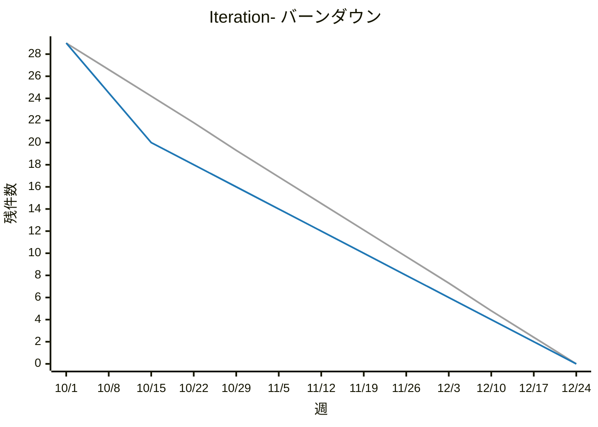

# バックログレポート: colors / Iteration-

| 接続先 | group | 期 | 基準日 |
|---|---|---|---|
| http://localhost:9080 | `colors` | `Iteration-`（10/1〜12/23、6 スプリント） | 2026-10-02 |

## サマリー

**進捗率 10%** `██░░░░░░░░░░░░░░░░░░` 3 / 29 件

| 指標 | 件数 |
|---|---:|
| 対象バックログ | 29 |
| 消化 | 3 |
| 残り（今日） | **26** |
| 予定線の今日の値 | 28.4 |
| 理想線の今日の値 | 28.7 |
| Icebox（open、参考） | 5 |

## バーンダウン

凡例: 灰 = 理想 / 青 = 予定 / 赤 = 実績

※ 3本の線は、すべて実行時点の割り当てから計算しています。スプリント間で移したバックログや、途中で追加したバックログは、過去の点にもさかのぼって反映されます（理想線の始点と予定線の段差は、当時の計画とは異なる場合があります）。
