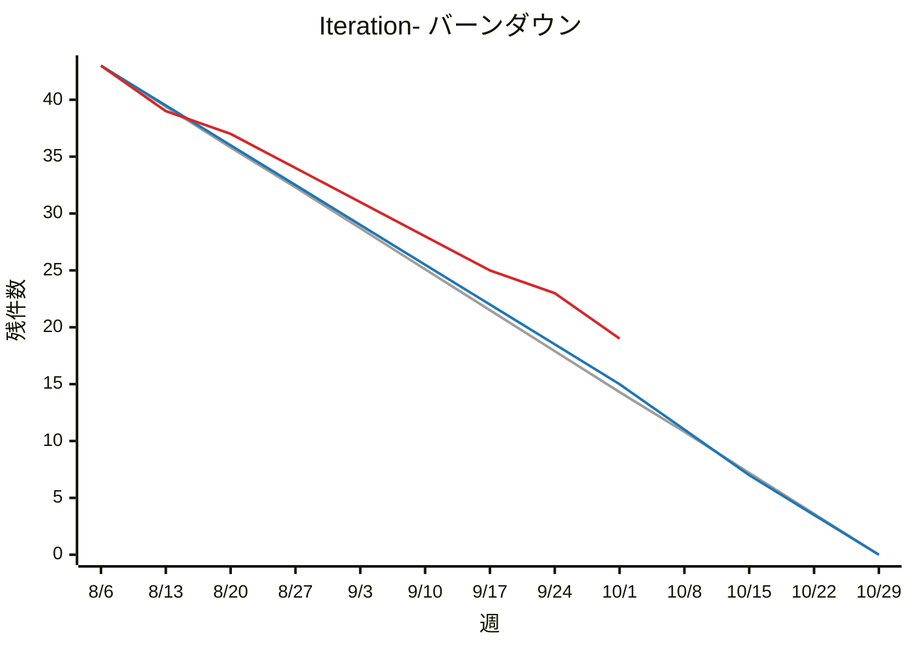

# バックログレポート: colors / Iteration-

| 接続先 | 集計範囲 | 対象スプリント | 基準日 |
|---|---|---|---|
| http://localhost:9080 | `colors`（group） | `Iteration-`（8/6〜10/28、6 スプリント） | 2026-10-07 |

## サマリー

**進捗率 60%** `████████████░░░░░░░░` 26 / 43 件

| 指標 | 件数 |
|---|---:|
| 対象バックログ | 43 |
| 消化 | 26 |
| 残り（今日） | **17** |
| 予定線の今日の値 | 11.6 |
| 理想線の今日の値 | 11.3 |
| Icebox（open、参考） | 5 |

現在のスプリント: **Iteration-5**（10/1〜10/14）

## バーンダウン

凡例: 灰 = 理想 / 青 = 予定 / 赤 = 実績

※ 3本の線は、すべて実行時点の割り当てから計算しています。スプリント間で移したバックログや、途中で追加したバックログは、過去の点にもさかのぼって反映されます（理想線の始点と予定線の段差は、当時の計画とは異なる場合があります）。

## バックログ状態

| open | ready | doing | review | close | 計 |
|---:|---:|---:|---:|---:|---:|
| 4 | 7 | 3 | 3 | 26 | 43 |

## スプリント別サマリー

| スプリント | 期間 | 状況 | 件数 | 消化 | 進捗率 |
|---|---|---|---:|---:|---|
| Iteration-1 | 8/6〜8/19 | 終了 | 7 | 6 | `█████████░` 86% |
| Iteration-2 | 8/20〜9/2 | 終了 | 7 | 6 | `█████████░` 86% |
| Iteration-3 | 9/3〜9/16 | 終了 | 7 | 6 | `█████████░` 86% |
| Iteration-4 | 9/17〜9/30 | 終了 | 7 | 6 | `█████████░` 86% |
| Iteration-5 | 10/1〜10/14 | 進行中 | 8 | 2 | `███░░░░░░░` 25% |
| Iteration-6 | 10/15〜10/28 | 未来 | 7 | 0 | `░░░░░░░░░░` 0% |

## 内訳

### ラベル別

| ラベル | 件数 | 消化 | 進捗率 |
|---|---:|---:|---:|
| `backend` | 18 | 11 | 61% |
| `frontend` | 12 | 7 | 58% |
| `type::bug` | 2 | 1 | 50% |
| `type::feature` | 21 | 14 | 67% |
| （なし） | 7 | 4 | 57% |

### 担当者別

| 担当者 | 件数 | 消化 | 残り |
|---|---:|---:|---:|
| @aka | 9 | 6 | 3 |
| @ao | 7 | 5 | 2 |
| @kuro | 8 | 6 | 2 |
| @midori | 7 | 4 | 3 |
| @shiro | 9 | 8 | 1 |
| （なし） | 10 | 2 | 8 |

※ 担当者が複数いるバックログは、それぞれの担当者に数えています。

## バックログ一覧

### Iteration-1（8/6〜8/19）

| issue | タイトル | 状態 | 担当者 | ラベル |
|---|---|---|---|---|
| [hello#1](http://localhost:9080/colors/hello/-/work_items/1) | ユーザー登録画面を作成する | close | @aka | `frontend` `type::feature` |
| [hello#2](http://localhost:9080/colors/hello/-/work_items/2) | ログイン画面を作成する | close | @aka, @ao | `frontend` `type::feature` |
| [hello#3](http://localhost:9080/colors/hello/-/work_items/3) | パスワードのハッシュ化を実装する | close | @kuro | `backend` |
| [hello#4](http://localhost:9080/colors/hello/-/work_items/4) | DB スキーマ（users, tasks）を設計する | close | @kuro, @shiro | `backend` |
| [hello#5](http://localhost:9080/colors/hello/-/work_items/5) | CI パイプラインを構築する | close | @midori | — |
| [world#1](http://localhost:9080/colors/world/-/work_items/1) | ステージング環境を構築する | close | @midori | — |
| [world#2](http://localhost:9080/colors/world/-/work_items/2) | ログ収集基盤を整備する | open | — | `backend` |

### Iteration-2（8/20〜9/2）

| issue | タイトル | 状態 | 担当者 | ラベル |
|---|---|---|---|---|
| [hello#6](http://localhost:9080/colors/hello/-/work_items/6) | タスク一覧 API を実装する | close | @shiro | `backend` `type::feature` |
| [hello#7](http://localhost:9080/colors/hello/-/work_items/7) | タスク一覧画面を作成する | close | @ao | `frontend` `type::feature` |
| [hello#8](http://localhost:9080/colors/hello/-/work_items/8) | タスク作成 API を実装する | close | @shiro | `backend` `type::feature` |
| [hello#9](http://localhost:9080/colors/hello/-/work_items/9) | タスク作成フォームを作成する | close | @ao, @aka | `frontend` |
| [hello#10](http://localhost:9080/colors/hello/-/work_items/10) | ログアウト機能を実装する | close | — | `type::feature` |
| [world#3](http://localhost:9080/colors/world/-/work_items/3) | 監視ダッシュボードを構築する | close | @midori | — |
| [world#4](http://localhost:9080/colors/world/-/work_items/4) | 管理者向けユーザー一覧画面を作成する | doing | @aka | `frontend` `type::feature` |

### Iteration-3（9/3〜9/16）

| issue | タイトル | 状態 | 担当者 | ラベル |
|---|---|---|---|---|
| [hello#11](http://localhost:9080/colors/hello/-/work_items/11) | タスク編集機能を実装する | close | @shiro, @ao | `type::feature` |
| [hello#12](http://localhost:9080/colors/hello/-/work_items/12) | タスク削除機能を実装する | close | @shiro | `backend` `type::feature` |
| [hello#13](http://localhost:9080/colors/hello/-/work_items/13) | タスクの完了／未完了を切り替えられるようにする | close | @ao | `frontend` |
| [hello#14](http://localhost:9080/colors/hello/-/work_items/14) | タスクに期限日を設定できるようにする | close | @kuro | `type::feature` |
| [hello#15](http://localhost:9080/colors/hello/-/work_items/15) | パスワードリセット機能を実装する | open | — | `backend` `type::feature` |
| [world#5](http://localhost:9080/colors/world/-/work_items/5) | 管理者向けユーザー停止機能を実装する | close | @kuro | `backend` `type::feature` |
| [world#6](http://localhost:9080/colors/world/-/work_items/6) | API ドキュメントを公開する | close | — | — |

### Iteration-4（9/17〜9/30）

| issue | タイトル | 状態 | 担当者 | ラベル |
|---|---|---|---|---|
| [hello#16](http://localhost:9080/colors/hello/-/work_items/16) | タスク一覧を期限日でソートできるようにする | close | @shiro | `backend` `type::feature` |
| [hello#17](http://localhost:9080/colors/hello/-/work_items/17) | タスクのキーワード検索を実装する | close | @kuro | `backend` `type::feature` |
| [hello#18](http://localhost:9080/colors/hello/-/work_items/18) | タスクにタグを付けられるようにする | close | @aka, @shiro | `type::feature` |
| [hello#19](http://localhost:9080/colors/hello/-/work_items/19) | タグでタスクを絞り込めるようにする | close | @aka | `frontend` |
| [hello#20](http://localhost:9080/colors/hello/-/work_items/20) | タスクの優先度を設定できるようにする | review | @ao | `type::feature` |
| [world#7](http://localhost:9080/colors/world/-/work_items/7) | エラー通知を Slack に送る | close | @midori | `backend` |
| [world#8](http://localhost:9080/colors/world/-/work_items/8) | 管理画面でユーザー名が文字化けする不具合を直す | close | @aka | `frontend` `type::bug` |

### Iteration-5（10/1〜10/14）

| issue | タイトル | 状態 | 担当者 | ラベル |
|---|---|---|---|---|
| [hello#21](http://localhost:9080/colors/hello/-/work_items/21) | ページネーションを実装する | close | @shiro | `backend` |
| [hello#22](http://localhost:9080/colors/hello/-/work_items/22) | 期限前日にメール通知を送る | review | @kuro, @midori | `backend` `type::feature` |
| [hello#23](http://localhost:9080/colors/hello/-/work_items/23) | プロフィール編集画面を作成する | review | @aka | `frontend` |
| [hello#24](http://localhost:9080/colors/hello/-/work_items/24) | レスポンシブデザインに対応する | doing | @ao | `frontend` |
| [hello#25](http://localhost:9080/colors/hello/-/work_items/25) | E2E テストを整備する | ready | @midori | — |
| [world#9](http://localhost:9080/colors/world/-/work_items/9) | 監査ログを記録する | close | @kuro | `backend` `type::feature` |
| [world#10](http://localhost:9080/colors/world/-/work_items/10) | 権限管理（ロール）を実装する | doing | @shiro, @kuro | `backend` `type::feature` |
| [world#11](http://localhost:9080/colors/world/-/work_items/11) | 負荷試験を実施する | ready | — | — |

### Iteration-6（10/15〜10/28）

| issue | タイトル | 状態 | 担当者 | ラベル |
|---|---|---|---|---|
| [hello#26](http://localhost:9080/colors/hello/-/work_items/26) | タスクをチームメンバーに共有できるようにする | ready | @aka | `type::feature` |
| [hello#27](http://localhost:9080/colors/hello/-/work_items/27) | タスクにコメントを付けられるようにする | ready | — | `frontend` `type::feature` |
| [hello#28](http://localhost:9080/colors/hello/-/work_items/28) | 操作履歴（アクティビティログ）を表示する | ready | — | `frontend` |
| [hello#29](http://localhost:9080/colors/hello/-/work_items/29) | 本番環境へのデプロイ手順を整備する | ready | @midori | — |
| [world#12](http://localhost:9080/colors/world/-/work_items/12) | バックアップを自動化する | ready | — | `backend` |
| [world#13](http://localhost:9080/colors/world/-/work_items/13) | 利用状況の集計バッチを作成する | open | — | `backend` |
| [world#14](http://localhost:9080/colors/world/-/work_items/14) | ログ収集でタイムゾーンがずれる不具合を直す | open | — | `backend` `type::bug` |

### Icebox（open、参考）

| issue | タイトル |
|---|---|
| [hello#30](http://localhost:9080/colors/hello/-/work_items/30) | ダークモードに対応する |
| [hello#31](http://localhost:9080/colors/hello/-/work_items/31) | タスクを CSV でエクスポートする |
| [hello#32](http://localhost:9080/colors/hello/-/work_items/32) | カレンダー表示を追加する |
| [hello#33](http://localhost:9080/colors/hello/-/work_items/33) | Google カレンダーと連携する |
| [hello#34](http://localhost:9080/colors/hello/-/work_items/34) | モバイルアプリ（PWA）化する |
