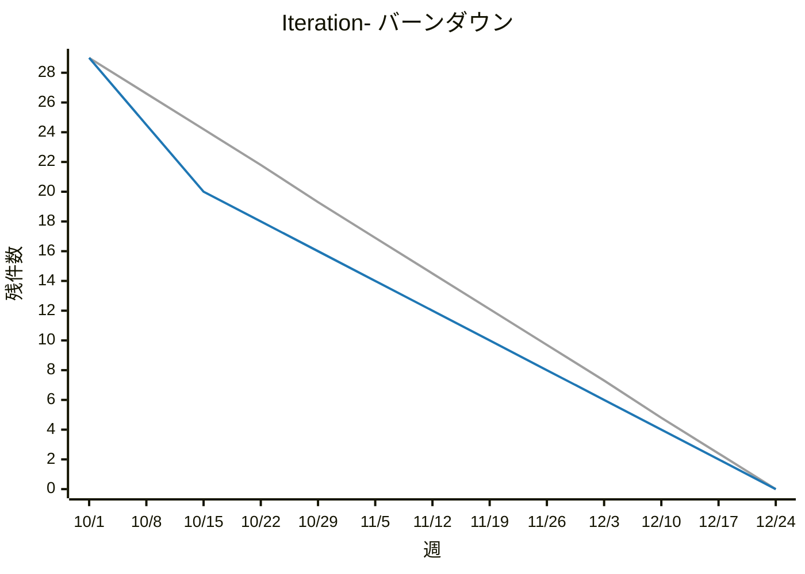

# バックログレポート: colors / Iteration-

| 接続先 | group | 期 | 基準日 |
|---|---|---|---|
| http://localhost:9080 | `colors` | `Iteration-`（10/1〜12/23、6 スプリント） | 2026-10-02 |

## サマリー

**進捗率 10%** `██░░░░░░░░░░░░░░░░░░` 3 / 29 件

| 指標 | 件数 |
|---|---:|
| 対象バックログ | 29 |
| 消化 | 3 |
| 残り（今日） | **26** |
| 予定線の今日の値 | 28.4 |
| 理想線の今日の値 | 28.7 |
| Icebox（open、参考） | 5 |

現在のスプリント: **Iteration-Q3-1**（10/1〜10/14）

## バーンダウン

凡例: 灰 = 理想 / 青 = 予定 / 赤 = 実績

※ 3本の線は、すべて実行時点の割り当てから計算しています。スプリント間で移したバックログや、途中で追加したバックログは、過去の点にもさかのぼって反映されます（理想線の始点と予定線の段差は、当時の計画とは異なる場合があります）。

## バックログ状態

| open | ready | doing | review | close | 計 |
|---:|---:|---:|---:|---:|---:|
| 0 | 22 | 2 | 2 | 3 | 29 |

## スプリント別サマリー

| スプリント | 期間 | 状況 | 件数 | 消化 | 進捗率 |
|---|---|---|---:|---:|---|
| Iteration-Q3-1 | 10/1〜10/14 | 進行中 | 9 | 3 | `███░░░░░░░` 33% |
| Iteration-Q3-2 | 10/15〜10/28 | 未来 | 4 | 0 | `░░░░░░░░░░` 0% |
| Iteration-Q3-3 | 10/29〜11/11 | 未来 | 4 | 0 | `░░░░░░░░░░` 0% |
| Iteration-Q3-4 | 11/12〜11/25 | 未来 | 4 | 0 | `░░░░░░░░░░` 0% |
| Iteration-Q3-5 | 11/26〜12/9 | 未来 | 4 | 0 | `░░░░░░░░░░` 0% |
| Iteration-Q3-6 | 12/10〜12/23 | 未来 | 4 | 0 | `░░░░░░░░░░` 0% |

## バックログ一覧

### Iteration-Q3-1（10/1〜10/14）

| issue | タイトル | 状態 | 担当者 | ラベル |
|---|---|---|---|---|
| [hello#1](http://localhost:9080/colors/hello/-/work_items/1) | ユーザー登録画面を作成する | close | — | — |
| [hello#2](http://localhost:9080/colors/hello/-/work_items/2) | ログイン画面を作成する | review | — | — |
| [hello#3](http://localhost:9080/colors/hello/-/work_items/3) | パスワードのハッシュ化を実装する | review | — | — |
| [hello#4](http://localhost:9080/colors/hello/-/work_items/4) | DB スキーマ（users, tasks）を設計する | close | — | — |
| [hello#5](http://localhost:9080/colors/hello/-/work_items/5) | タスク一覧 API を実装する | doing | — | — |
| [hello#6](http://localhost:9080/colors/hello/-/work_items/6) | タスク一覧画面を作成する | doing | — | — |
| [hello#7](http://localhost:9080/colors/hello/-/work_items/7) | CI パイプラインを構築する | close | — | — |
| [hello#8](http://localhost:9080/colors/hello/-/work_items/8) | タスク作成 API を実装する | ready | — | — |
| [hello#9](http://localhost:9080/colors/hello/-/work_items/9) | タスク作成フォームを作成する | ready | — | — |

### Iteration-Q3-2（10/15〜10/28）

| issue | タイトル | 状態 | 担当者 | ラベル |
|---|---|---|---|---|
| [hello#10](http://localhost:9080/colors/hello/-/work_items/10) | タスク編集機能を実装する | ready | — | — |
| [hello#11](http://localhost:9080/colors/hello/-/work_items/11) | タスク削除機能を実装する | ready | — | — |
| [hello#12](http://localhost:9080/colors/hello/-/work_items/12) | タスクの完了／未完了を切り替えられるようにする | ready | — | — |
| [hello#13](http://localhost:9080/colors/hello/-/work_items/13) | ログアウト機能を実装する | ready | — | — |

### Iteration-Q3-3（10/29〜11/11）

| issue | タイトル | 状態 | 担当者 | ラベル |
|---|---|---|---|---|
| [hello#14](http://localhost:9080/colors/hello/-/work_items/14) | タスクに期限日を設定できるようにする | ready | — | — |
| [hello#15](http://localhost:9080/colors/hello/-/work_items/15) | タスク一覧を期限日でソートできるようにする | ready | — | — |
| [hello#16](http://localhost:9080/colors/hello/-/work_items/16) | タスクのキーワード検索を実装する | ready | — | — |
| [hello#17](http://localhost:9080/colors/hello/-/work_items/17) | パスワードリセット機能を実装する | ready | — | — |

### Iteration-Q3-4（11/12〜11/25）

| issue | タイトル | 状態 | 担当者 | ラベル |
|---|---|---|---|---|
| [hello#18](http://localhost:9080/colors/hello/-/work_items/18) | タスクにタグを付けられるようにする | ready | — | — |
| [hello#19](http://localhost:9080/colors/hello/-/work_items/19) | タグでタスクを絞り込めるようにする | ready | — | — |
| [hello#20](http://localhost:9080/colors/hello/-/work_items/20) | タスクの優先度を設定できるようにする | ready | — | — |
| [hello#21](http://localhost:9080/colors/hello/-/work_items/21) | ページネーションを実装する | ready | — | — |

### Iteration-Q3-5（11/26〜12/9）

| issue | タイトル | 状態 | 担当者 | ラベル |
|---|---|---|---|---|
| [hello#22](http://localhost:9080/colors/hello/-/work_items/22) | 期限前日にメール通知を送る | ready | — | — |
| [hello#23](http://localhost:9080/colors/hello/-/work_items/23) | プロフィール編集画面を作成する | ready | — | — |
| [hello#24](http://localhost:9080/colors/hello/-/work_items/24) | レスポンシブデザインに対応する | ready | — | — |
| [hello#25](http://localhost:9080/colors/hello/-/work_items/25) | E2E テストを整備する | ready | — | — |

### Iteration-Q3-6（12/10〜12/23）

| issue | タイトル | 状態 | 担当者 | ラベル |
|---|---|---|---|---|
| [hello#26](http://localhost:9080/colors/hello/-/work_items/26) | タスクをチームメンバーに共有できるようにする | ready | — | — |
| [hello#27](http://localhost:9080/colors/hello/-/work_items/27) | タスクにコメントを付けられるようにする | ready | — | — |
| [hello#28](http://localhost:9080/colors/hello/-/work_items/28) | 操作履歴（アクティビティログ）を表示する | ready | — | — |
| [hello#29](http://localhost:9080/colors/hello/-/work_items/29) | 本番環境へのデプロイ手順を整備する | ready | — | — |

### Icebox（open、参考）

| issue | タイトル |
|---|---|
| [hello#30](http://localhost:9080/colors/hello/-/work_items/30) | ダークモードに対応する |
| [hello#31](http://localhost:9080/colors/hello/-/work_items/31) | タスクを CSV でエクスポートする |
| [hello#32](http://localhost:9080/colors/hello/-/work_items/32) | カレンダー表示を追加する |
| [hello#33](http://localhost:9080/colors/hello/-/work_items/33) | Google カレンダーと連携する |
| [hello#34](http://localhost:9080/colors/hello/-/work_items/34) | モバイルアプリ（PWA）化する |
